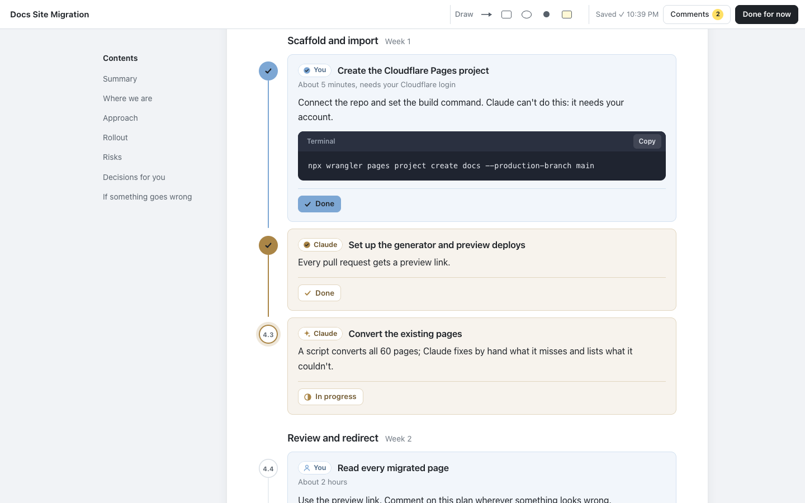

# plan-maker

A Claude Code plugin that turns plans into HTML pages you review in the browser.

Ask Claude for a plan, or to guide you through something, and it writes a page instead of a wall of chat. It reads like a shared doc: a rounded page with plain, comfortable text. Every step is a card, blue if it's yours and gold if it's Claude's. You read it, work through it and comment as you go:

- **select any text → Comment** or **Ask Claude**, or use **Comment** on any block or section
- tick off **your steps** with **Mark done**, and watch **Claude's steps** move from to do, to in progress, to done
- answer the pick-one **decisions** (Claude marks its recommendation)
- **Draw** arrows, boxes, circles, points and sticky notes anywhere on the page, from tools always on screen in the top bar
- write general notes

A tiny local server saves everything to `notes.json` beside the plan as you type. When you're done, press **Done for now** and say **"process my notes"**. Claude then writes the next version:
- it works through every comment and settles your decisions;
- it answers each question right where you asked it;
- the steps you ticked off stay ticked.

The new version opens with a **What changed** section, and every earlier version stays one click away, read-only, with the notes you wrote on it.


It works for any plan in any project. Plain HTML works too: a page without the conventions below gets stable ids from its headings, so even Markdown converted to HTML can be annotated.

### One kind of page: your steps and Claude's

Every plan can hold **steps**, and every step has an owner:

| Owner | Marked | What you do with it |
|---|---|---|
| **You** | blue card | **Mark done** when you've done it. It's for anything needing your login, money, judgement or a click only you can make. |
| **Claude** | gold card | Nothing: Claude sets its status (to do, in progress, done) and keeps it current. |
| **You + Claude** | blue card | Claude prepares it, you confirm it, then tick it off. |



The top bar shows both lanes at once, **You 2/6** and **Claude 7/9**, so you can always see what's waiting on you. A walkthrough ("guide me through moving DNS to Cloudflare", or `/plan-maker:guide …`) is simply a plan whose steps are mostly yours. Code blocks are dark, with a header showing their label ("Terminal", a file name) and a **Copy** button.

### The hub: every plan in one place

Every plan Claude writes is registered in one list across all your projects: `~/.plan-maker/registry.json`. Say **"show my plans"** or use `/plan-maker:plans` to open the hub.

- **The sidebar** lists your projects, each with its plans nested underneath. Plans waiting on you come first, then the rest by most recent.
- **The opening view** is everything waiting on you, across every project: plans to review, decisions to answer, notes to hand back to Claude, and your steps left ("3 of your steps left: Point DNS at Cloudflare").
- **A selected plan** shows its name, goal, description, status (which you can change), both progress lanes, the next action and a dated progress log. **Open** starts that plan's review server if it isn't running and takes you there.

Already have plans? Say **"register my plans"** in a project: Claude finds every plan-maker page under it, then fills in each one's goal and description.

## Install

In Claude Code:

```
/plugin marketplace add crathgeb/plan-maker
/plugin install plan-maker@plan-maker
```

Requires Node 18 or later. The server has no dependencies.

## Use

Just ask for a plan ("plan the migration to the new billing provider", "write up a proposal for…", "guide me through setting up Search Console"). Or use a command:

```
/plan-maker:plan migrate the docs site to a static generator
/plan-maker:guide move our DNS to Cloudflare
/plan-maker:plans
```

| Skill | When it runs | What it does |
|---|---|---|
| `make-plan` | You ask for a plan, proposal, strategy or walkthrough, or Claude is about to present a big one | Writes the plan to `plans/<slug>/index.html` (or a path you name) from the template, with every step owned by you or Claude. Then it registers the plan, starts the review server and gives you the URL |
| `review-plan` | You want to reopen a plan, or share one for offline review | Starts the server for an existing plan, or reuses the one already running |
| `process-plan-notes` | You say "process my notes", "I've reviewed the plan" or "answer my questions" | Maps every comment and question to its element and shows a short table of changes. Then it saves the reviewed version under `versions/` and writes the next version: it applies your notes, answers your questions where you asked them, keeps your ticked steps, updates Claude's step statuses and adds a "What changed" section |
| `plan-registry` | You ask what plans you have, want the hub, say "register my plans" or tell Claude a plan's status | Opens the hub, registers existing pages, records status, next action and progress. The other skills register and log as they go |

### Versions


Before a plan is revised, `process-plan-notes` saves it, so nothing you reviewed is ever lost:

```
plans/docs-migration/
  index.html             the live plan (v3)
  notes.json             your notes on v3, as you write them
  versions/
    v1.html              v1, exactly as you reviewed it
    v1.notes.json        the notes you wrote on v1
    v2.html
    v2.notes.json
```

- The **v3** switcher in the top bar lists every version with its date and a summary of its notes. Older versions open read-only, with a banner and a link back to the current one. Your highlights, verdicts, decisions and notes from that round are shown, and the controls are disabled.
- Each revision starts with **What changed in vN**: a table of "You said → What changed", with links to the sections it touched, plus the decisions you took. Elements edited in that version carry a small "changed in vN" badge.
- A browser tab still showing an older version can't save onto the new one: the server refuses, and the toolbar says to reload.
- A plan with no `versions/` folder works as before, with no switcher.

### Without Claude

The scripts work on their own:

```bash
# Review any HTML file. Notes go to notes.json beside it.
node scripts/review.mjs path/to/plan.html [--port 4478] [--host 127.0.0.1] [--trust tailnet] [--no-open]

# Save the live plan as versions/v<N>.html and move its notes beside it.
# Never overwrites an existing snapshot.
node scripts/snapshot.mjs path/to/plan.html

# The registry and the hub. Set PLAN_MAKER_HOME to keep the registry somewhere else.
node scripts/registry.mjs add path/to/plan.html --goal "…" [--name …] [--description …] [--status …] [--next …]
node scripts/registry.mjs update <page|id> [--status in-progress] [--log "Phase 1 done"]
node scripts/registry.mjs list [--all] [--project NAME] [--json]
node scripts/registry.mjs scan [dir]        # register every plan-maker page under dir
node scripts/hub.mjs [--port 4477] [--no-open]

# Write a self-contained copy for sharing or opening from disk.
# --all-versions also writes each earlier version, read-only, linked by the switcher.
node scripts/bundle.mjs path/to/plan.html [-o out.html] [--with-notes] [--all-versions]
```

The server binds to 127.0.0.1 by default. If port 4478 is taken it uses the next free one. If a server is already serving the same plan, it prints that URL and exits. It reads the plan fresh on every load, so a reload shows Claude's edits.

**Reviewing from another device.** `--host 0.0.0.0` listens on every interface (Wi-Fi, Ethernet, a VPN such as Tailscale), and `--host <address>` listens on just one. Set `PLAN_MAKER_HOST` in your shell profile to make it the default on that machine. Beyond loopback the server prints a URL for each address with a `?key=` that changes every run. Opening it once stores the key in a cookie. Requests without the key get 403, which also covers DNS rebinding. This machine still reaches `http://127.0.0.1:<port>/` without the key.

`--trust tailnet` (or `PLAN_MAKER_TRUST=tailnet`) lets devices on your Tailscale network in without the key, which is handy on a phone. `tailnet` means Tailscale's ranges, `100.64.0.0/10` and `fd7a:115c:a1e0::/48`. IPv4 CIDRs work too: `--trust tailnet,192.168.1.0/24`. A trusted request must address the server by an IP address, a `*.ts.net` name or this machine's hostname. A DNS rebinding page sends its own domain and is still refused. For example, `PLAN_MAKER_HOST=100.x.y.z PLAN_MAKER_TRUST=tailnet` in your shell profile makes every review reachable only over Tailscale, with no key.

| Route | |
|---|---|
| `GET /` | The live plan with the annotation layer |
| `GET /versions/v<N>` | Version N, read-only, with its notes |
| `GET /api/versions` | Every version, newest first: `{ current, versions: [{ version, current, href, date, summary }] }` |
| `GET /api/notes`, `PUT /api/notes` | The live plan's notes. Requests from a version page get that version's notes, and its saves are refused. |

The bundled copy has the annotation layer inlined. Opened from disk, it saves in the browser and offers **Download notes.json**; put that file beside the plan. Images the plan links to are not inlined.

## How it works

`lib/annotator.js` and `lib/annotator.css` are the whole review layer. The script builds its own notes panel, selection popover, toolbar and dialog, so a plan is plain HTML with no script of its own. The server injects the layer before `</body>` on every request; the bundle command inlines it once. All the layer's classes start with `pm-`, so it sits on top of any page's styles. A page can recolour it by setting the `--pm-*` tokens (`--pm-you`, `--pm-claude`, `--pm-paper`, `--pm-ink`…) on `:root`. DESIGN.md describes the visual system.

An older version saved with its own review script (from before plan-maker) is shown as it was: the server gives that script the version's notes, refuses its saves, and plan-maker adds only the read-only banner and the switcher.

Highlights are stored as character offsets within a block, counting only the plan's own text (never the layer's buttons), plus the quoted text. When the plan changes, a highlight is found again by its quote in the same block, then anywhere in the plan.

## HTML conventions

`templates/plan.html` shows each of these in use, (light and dark, down to phone width). DESIGN.md has the visual system.

| Mark | Effect |
|---|---|
| `data-id="…"` | Makes a block annotatable. Selected text is attributed to the nearest block with a `data-id`. Use unique, stable, kebab-case ids. |
| `class="item"` | Adds a **Comment** button: entries, table rows (`<tr>`), list items, whole tables, code blocks. |
| `<pre data-label="Terminal">` | A code block; the label shows in its header beside **Copy**. |
| `class="step" data-who="you\|claude\|both"` | A step and its owner. Yours (and both) are blue cards with **Mark done**; Claude's are gold cards with their status. Each counts toward its owner's lane in the top bar. Older pages with `.who.you` / `.who.claude` tags inside steps still work. |
| `data-status="todo\|doing\|done"` | On a Claude step: its status, set by Claude. |
| `aside.explain[data-q]` | Claude's answer to your question, written where you asked it. |
| `<section data-id>` | Adds a section note after the section's heading. |
| `<div class="decision" data-decision="key">` | A pick-one question: radio inputs sharing `name="key"`, the option's name in `<b>`, and `<span class="rec">Recommended</span>` on the recommended option. The layer adds a note field. |
| `<main data-plan>` | The annotatable area (default: `<main>`, else `<body>`). |
| `<meta name="plan-version" content="N">` | The version, recorded in the notes and shown in the switcher; `process-plan-notes` bumps it. Without it, the slug's "Plan vN" is used. |
| `<meta name="plan-date" content="YYYY-MM-DD">` | The version's date in the switcher. |
| `section#changes` | "What changed in vN", the first section of every revision. See `templates/changes-section.html`. |
| `data-changed="vN"` | Shows a "changed in vN" badge on that element while viewing vN. |
| `data-no-annotate` | Leaves an element and its contents alone. |

Drawings are anchored to the block under where you start drawing (or the page), stored as fractions of that block's box, so they stay on the same content when the page reflows or is opened on a phone.

**No `data-id`s at all?** The page assigns them from the headings: each heading gets its slug (`risks`), the blocks under it are numbered (`risks-1`, `risks-2`…), and a repeated heading becomes `risks--2`. Paragraphs, list items, table rows, code blocks and quotes get a Comment button, and each `<h2>` gets a section comment. The same content always gets the same ids. `notes.json` then has `"autoIds": true`, and every entry carries `where` and `excerpt` so it can be matched to the source.

## notes.json

```json
{
  "version": 1,
  "plan": "plans/docs-migration/index.html",
  "planVersion": "1",
  "title": "Docs Site Migration",
  "updatedAt": "2026-11-07T14:02:11.000Z",
  "doneAt": "2026-11-07T14:05:40.000Z",
  "autoIds": false,
  "general": "Direction looks right. Tighten the timeline.",
  "items": {
    "ph-2": { "where": "Rollout › Generate and test the redirect map", "excerpt": "Claude Generate and test the redirect map …", "kind": "note", "note": "Two weeks, not one" },
    "approach": { "where": "Section: How it works", "excerpt": "…", "kind": "question", "note": "Why not keep the CMS for the blog?" }
  },
  "highlights": [
    { "id": "k3j9a1x", "n": 1, "blockId": "ap-source", "where": "How it works › One source.", "quote": "Pages are Markdown files", "start": 12, "end": 36, "note": "Per package?", "createdAt": "…" }
  ],
  "decisions": {
    "generator": { "question": "Which generator?", "choice": "docusaurus", "label": "Docusaurus", "recommended": "astro", "note": "We need versioning" }
  }
}
```

| Field | Contents |
|---|---|
| `version` | Schema version (1) |
| `plan`, `planVersion`, `title` | Which plan and which version of it was reviewed |
| `general` | Notes on the plan as a whole |
| `items.<data-id>` | An entry, row, step or section: `note` (the comment); `kind` (`note`, or `question` for Claude); notes from older versions may carry a `verdict`; `where` (a readable location); `excerpt` (its text). `noteOpen` is UI state. |
| `highlights[]` | A note on selected text: `quote` is the exact text inside the element whose `data-id` is `blockId`, at characters `start`–`end` of that element's text. `n` is the number shown on the page. `orphaned` is set when the text can no longer be found. |
| `decisions.<key>` | `question`, the `choice` (radio value), its `label`, Claude's `recommended` value, and an optional `note` |
| `drawings[]` | A mark drawn on the page: `shape` (`arrow`, `box`, `circle`, `point`, `note` for a sticky note), the block it sits on (`blockId`, `null` for the page, with `where` and `excerpt`), `x1, y1, x2, y2` as fractions of that block's box (an arrow points from 1 to 2), `n` (shared numbering with highlights) and `note` |
| `steps` | `steps.<data-id>` is `{ done, doneAt, where }` for each of your steps marked done. It carries over to the next version. Every note-bearing entry (item, highlight, drawing) also has `kind`: `question` or `note`. |
| `autoIds` | `true` when the ids were assigned in the browser |
| `doneAt` | When **Done for now** was last pressed |

After a revision, the notes move to `versions/v<N>.notes.json` (plan-maker 0.1 archived them as `notes-v<N>.json` beside the plan; that name is still read).

## Development

```bash
npm install          # playwright-core, for the tests only
npm test             # end-to-end tests in Chrome
npm run screenshot   # regenerates docs/screenshot.png and docs/versions.png
```

The tests drive the system Chrome (`/Applications/Google Chrome.app/…` on macOS; set `CHROME_PATH` elsewhere). They cover: selecting text and saving a note, highlights restored after a reload, comments on blocks and sections, questions, general notes, your steps and Claude's with both lanes, decisions, the server's host, content-type and path checks, reusing a running server, no horizontal scroll at phone width, no console errors, ids assigned to plain HTML, and the standalone bundle. For versions: snapshots (and refusing to overwrite one), the switcher, an old version read-only with its notes and disabled controls, a stale tab unable to save, the current version still saving, links between versions, an older page with its own review script, and `bundle --all-versions`.

## License

MIT © TechSnack LLC
