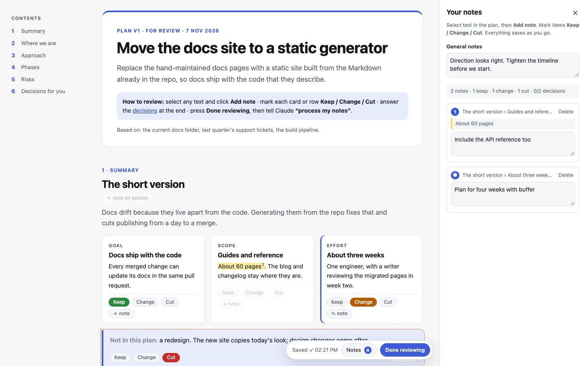
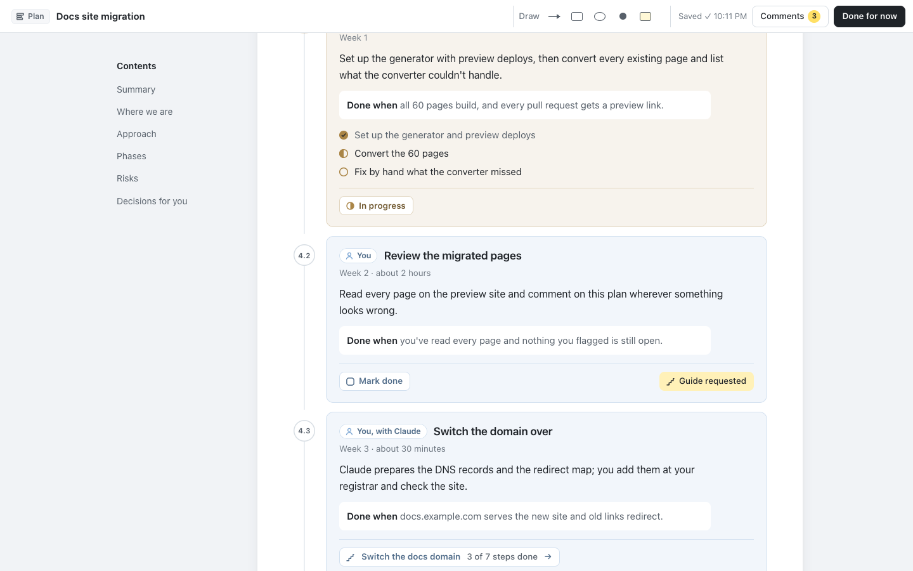
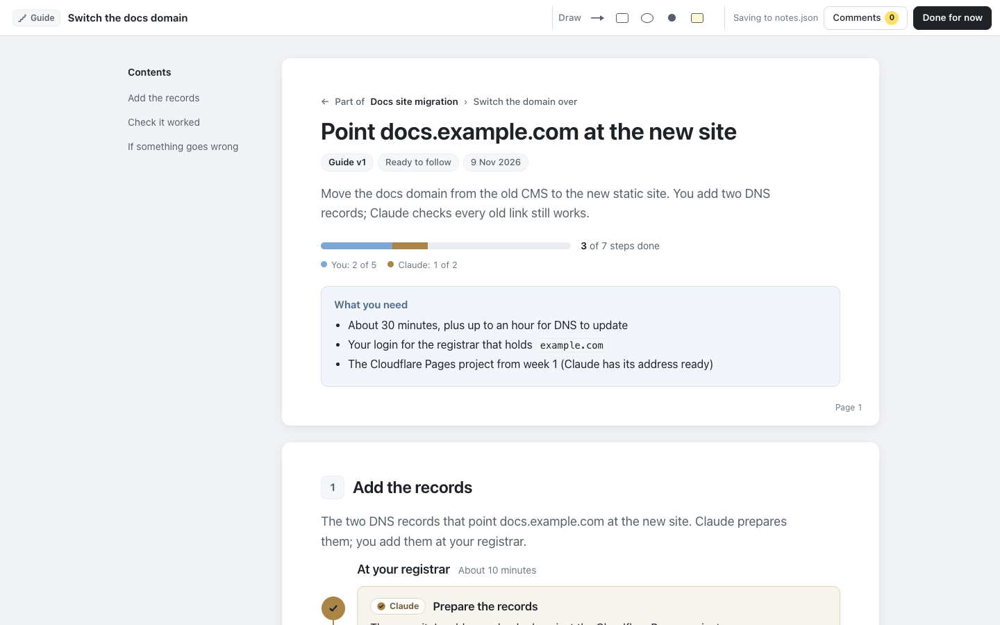
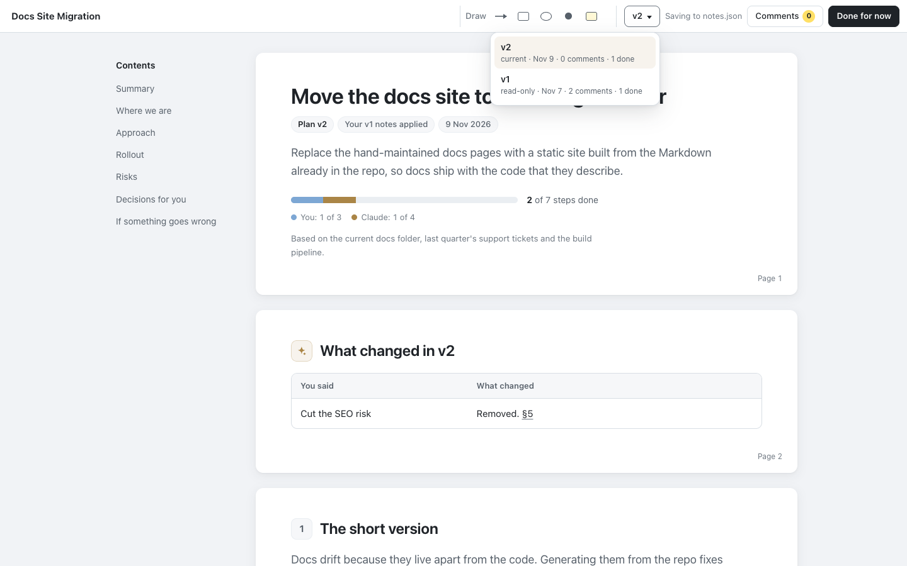

# plan-maker

A Claude Code plugin that writes plans, guides and references as HTML pages you review in the browser.

Ask Claude for a plan, to guide you through something, or to document how something works, and it writes a page instead of a wall of chat. It reads like a shared doc: a rounded page with plain, comfortable text. You read it, work through it and comment as you go:

- **select any text → Comment**, **Ask Claude** or **More detail**, or use the same buttons on any block or section
- on a plan, press **Make a guide** on any phase you want walked through
- tick off **your part** with **Mark done**, and watch **Claude's** move from to do, to in progress, to done
- answer the pick-one **decisions** (Claude marks its recommendation)
- **Draw** arrows, boxes, circles, points and sticky notes anywhere on the page, from tools always on screen in the top bar
- write general notes

A tiny local server saves everything to `notes.json` beside the page as you type. When you're done, press **Done for now** and say **"process my notes"**. Claude then writes the next version:
- it works through every comment and settles your decisions;
- it answers each question right where you asked it, and adds the detail you asked for;
- it writes the guides you requested and links them from their phases;
- what you ticked off stays ticked.

The new version opens with a **What changed** section, and every earlier version stays one click away, read-only, with the notes you wrote on it.



It works in any project. Plain HTML works too: a page without the conventions below gets stable ids from its headings, so even Markdown converted to HTML can be annotated.

### Three kinds of page

| | **Plan** | **Guide** | **Reference** |
|---|---|---|---|
| For | Breaking a larger idea into a high-level sequence | Getting you through one task | Explaining a system so you can look things up |
| Made of | **Phases**: a goal, an outcome, an owner, a status | **Steps**: one action each, what to paste, what you should see | **Sections**: options, commands, terms, examples |
| Ask for it | "plan the billing migration", `/plan-maker:plan` | "guide me through moving DNS", `/plan-maker:guide` | "document the build pipeline", `/plan-maker:reference` |

All three are reviewed the same way, versioned the same way and listed in the same hub, in the same design.

**Plans** say what happens, in what order, and who owns each part. Each phase is a card: blue if it's yours, gold if it's Claude's (Claude's can carry a short checklist so you see its progress). When your part of a phase needs steps, it gets a **guide**: the phase links to it, shows its progress, and is done when the guide is. Press **Make a guide** on a phase and Claude writes it in the next round.



**Guides** are written to be followed: what you need first, then one action per step, with **Copy** on everything to paste, "You should see" and "If it fails" in the step. **Mark done** brings the next step into view. A guide made from a plan says so above its title and links back.



**References** have no steps and no progress: contents on the cover, tables and definitions, examples beside what they show. A reference names the files it describes, so when one of them changes, the page and the hub say it's out of date.

### The hub: everything in one place

Every page Claude writes is registered in one list across all your projects: `~/.plan-maker/registry.json`. Say **"show my plans"** or use `/plan-maker:plans` to open the hub.

- **The sidebar** lists your projects, each with its pages underneath, marked plan, guide or reference. A guide made from a plan sits under it. Anything waiting on you comes first, then the rest by most recent. A filter shows all, or just plans, guides or references.
- **The opening view** is everything waiting on you, across every project: pages to review, decisions to answer, notes and guide requests to hand back to Claude, your steps left ("3 of your steps left: Point DNS at Cloudflare"), and references gone out of date.
- **A selected page** is the page itself, live, with its status (which you can change) and progress in its own top bar. Set it to **Done** or **Archived** and it moves to the collapsed "Done and archived" group. **Remove from hub…**, at the bottom of the same menu, takes it off the hub entirely; the page, its notes and versions stay on disk. A page that was deleted or moved has a **Remove from hub** button on its view.
- **Running servers** lists every review server on this machine: its page, project and port, and whether a tab has it open. Orphans (a page that was deleted or moved, a second server for the same page) are flagged, and **Stop** works on one server, on the orphans, or on everything not in use. Servers also stop themselves after 12 hours with no tab open, and opening a page from the hub starts its server again.

Already have pages? Say **"register my plans"** in a project: Claude finds every plan-maker page under it, then fills in each one's goal and description.

## Install

In Claude Code:

```
/plugin marketplace add crathgeb/plan-maker
/plugin install plan-maker@plan-maker
```

Requires Node 18 or later. The server has no dependencies.

## Use

Just ask ("plan the migration to the new billing provider", "guide me through setting up Search Console", "write a reference for our deploy pipeline"). Or use a command:

```
/plan-maker:plan migrate the docs site to a static generator
/plan-maker:guide move our DNS to Cloudflare
/plan-maker:reference the docs build pipeline
/plan-maker:plans
```

| Skill | When it runs | What it does |
|---|---|---|
| `make-plan` | You ask for a plan, proposal, strategy or roadmap, or Claude is about to present a big one | Writes the plan to `plans/<slug>/index.html` (or a path you name) from the template, in parts: **Information** (what to know, including the risks), **Steps** (the phases, each owned by you or Claude, with guides for the ones you'll do soon), **Questions** (what only you can decide, while anything is open) and the **Decision log** (what's been decided, and the project's ADRs). The contents rail lists each part's sections under it, and every phase under Steps with a check once it's done. Then it registers the plan, starts the review server and gives you the URL |
| `make-guide` | You ask to be guided or walked through something, want setup steps or a runbook, or ask for a guide for a plan's phase | Writes a guide from its template, inside the plan's folder when it's for a phase (`plans/<plan>/guides/<slug>/`), and links the phase to it |
| `make-reference` | You ask for reference documentation of a system, API, config or pipeline | Writes a reference from its template, naming the files it describes so it can tell when it's out of date |
| `review-plan` | You want to reopen a page, or share one for offline review | Starts the server for an existing page, or reuses the one already running |
| `process-notes` | You say "process my notes", "I've reviewed the plan", "answer my questions" or "refresh the reference" | Maps every comment, question and request to its element and shows a short table of changes. Then it saves the reviewed version under `versions/` and writes the next version: it applies your notes, answers your questions where you asked them, adds the detail you asked for, writes the guides you requested, keeps what you ticked off, updates Claude's statuses and adds a "What changed" section |
| `plan-registry` | You ask what you have, want the hub, say "register my plans" or tell Claude a page's status | Opens the hub, registers existing pages, records status, next action and progress. The other skills register and log as they go |

### Versions



Before a page is revised, `process-notes` saves it, so nothing you reviewed is ever lost:

```
plans/docs-migration/
  index.html             the live plan (v3)
  notes.json             your notes on v3, as you write them
  versions/
    v1.html              v1, exactly as you reviewed it
    v1.notes.json        the notes you wrote on v1
    v2.html
    v2.notes.json
  guides/
    dns-cutover/         a guide made from one of its phases, versioned the same way
      index.html
      notes.json
```

- The **v3** switcher in the top bar lists every version with its date and a summary of its notes. Older versions open read-only, with a banner and a link back to the current one. Your highlights, verdicts, decisions and notes from that round are shown, and the controls are disabled.
- Each revision starts with **What changed in vN**: a table of "You said → What changed", with links to the sections it touched, plus the decisions you took. Elements edited in that version carry a small "changed in vN" badge.
- A browser tab still showing an older version can't save onto the new one: the server refuses, and the toolbar says to reload.
- A plan with no `versions/` folder works as before, with no switcher.

### Without Claude

The scripts work on their own:

```bash
# Review any HTML file. Notes go to notes.json beside it.
node scripts/review.mjs path/to/plan.html [--port 4478] [--host 127.0.0.1] [--trust tailnet] [--idle-hours 12] [--no-open]

# Save the live plan as versions/v<N>.html and move its notes beside it.
# Never overwrites an existing snapshot.
node scripts/snapshot.mjs path/to/plan.html

# The registry and the hub. Set PLAN_MAKER_HOME to keep the registry somewhere else.
node scripts/registry.mjs add path/to/plan.html --goal "…" [--name …] [--description …] [--status …] [--next …]
node scripts/registry.mjs update <page|id> [--status in-progress] [--log "Phase 1 done"]
node scripts/registry.mjs list [--all] [--project NAME] [--kind plan|guide|reference] [--json]
node scripts/registry.mjs scan [dir]        # register every plan-maker page under dir
node scripts/hub.mjs [--port 4477] [--no-open]

# Check a page after writing it: structure, leftover template example, WRITING.md rules.
# Errors (exit 1) break the page; warnings break a writing rule.
node scripts/check.mjs path/to/page.html [more pages…] [--json]

# Write a self-contained copy for sharing or opening from disk.
# --all-versions also writes each earlier version, read-only, linked by the switcher.
# A plan's guides are bundled with it, linked both ways, unless --no-guides.
node scripts/bundle.mjs path/to/plan.html [-o out.html] [--with-notes] [--all-versions] [--no-guides]
```

The server binds to 127.0.0.1 by default. If port 4478 is taken it tries the next 19, then any free port. If a server is already serving the same plan, it prints that URL and exits. It reads the plan fresh on every load, so a reload shows Claude's edits.

While it runs, a server keeps a record in `~/.plan-maker/servers/` so the hub can list and stop it. An open tab pings it once a minute. After `--idle-hours` (or `PLAN_MAKER_IDLE_HOURS`; default 12, `0` for never) with no tab open, it stops itself. Time the computer spends asleep doesn't count.

**Reviewing from another device.** `--host 0.0.0.0` listens on every interface (Wi-Fi, Ethernet, a VPN such as Tailscale), and `--host <address>` listens on just one. Set `PLAN_MAKER_HOST` in your shell profile to make it the default on that machine. Beyond loopback the server prints a URL for each address with a `?key=` that changes every run. Opening it once stores the key in a cookie. Requests without the key get 403, which also covers DNS rebinding. This machine still reaches `http://127.0.0.1:<port>/` without the key.

`--trust tailnet` (or `PLAN_MAKER_TRUST=tailnet`) lets devices on your Tailscale network in without the key, which is handy on a phone. `tailnet` means Tailscale's ranges, `100.64.0.0/10` and `fd7a:115c:a1e0::/48`. IPv4 CIDRs work too: `--trust tailnet,192.168.1.0/24`. A trusted request must address the server by an IP address, a `*.ts.net` name or this machine's hostname. A DNS rebinding page sends its own domain and is still refused. For example, `PLAN_MAKER_HOST=100.x.y.z PLAN_MAKER_TRUST=tailnet` in your shell profile makes every review reachable only over Tailscale, with no key.

| Route | |
|---|---|
| `GET /` | The live plan with the annotation layer |
| `GET /versions/v<N>` | Version N, read-only, with its notes |
| `GET /api/versions` | Every version, newest first: `{ current, versions: [{ version, current, href, date, summary }] }` |
| `GET /api/notes`, `PUT /api/notes` | The live plan's notes. Requests from a version page get that version's notes, and its saves are refused. |
| `GET /api/status`, `PUT /api/status` | The page's kind, the statuses it can have, its registry status, and (for a reference) the source files changed since it was written. `PUT { status }` changes it. |
| `GET /api/links` | Where the page's links lead: each phase's guide with its progress, and a guide's plan and phase |
| `GET /api/open?href=…` | Starts (or reuses) the review server for a linked plan-maker page in the same project, and redirects to it |

The bundled copy has the annotation layer inlined. Opened from disk, it saves in the browser and offers **Download notes.json**; put that file beside the page. Images the page links to are not inlined.

## How it works

`lib/annotator.js` and `lib/annotator.css` are the whole review layer, for every kind of page. It reads the page's `<meta name="pm-kind">` and adjusts only what differs: the kind chip and statuses in the top bar, what counts as progress (a plan's phases, a guide's steps, nothing on a reference), Make a guide on phases, and the way back from a guide to its plan. The script builds its own notes panel, selection popover, toolbar and dialog, so a page is plain HTML with no script of its own. The server injects the layer before `</body>` on every request; the bundle command inlines it once. All the layer's classes start with `pm-`, so it sits on top of any page's styles. A page can recolour it by setting the `--pm-*` tokens (`--pm-you`, `--pm-claude`, `--pm-paper`, `--pm-ink`…) on `:root`. DESIGN.md describes the visual system.

An older version saved with its own review script (from before plan-maker) is shown as it was: the server gives that script the version's notes, refuses its saves, and plan-maker adds only the read-only banner and the switcher.

Highlights are stored as character offsets within a block, counting only the plan's own text (never the layer's buttons), plus the quoted text. When the plan changes, a highlight is found again by its quote in the same block, then anywhere in the plan.

## HTML conventions

`templates/plan.html`, `templates/guide.html` and `templates/reference.html` show each of these in use (light and dark, down to phone width). The three share one style block, word for word. DESIGN.md has the visual system, and WRITING.md the writing rules every page follows: content kept apart from steps, a lede on every section, content concise enough to skim.

| Mark | Effect |
|---|---|
| `<meta name="pm-kind" content="plan\|guide\|reference">` | What kind of page this is. Without it, a plan. |
| `data-id="…"` | Makes a block annotatable. Selected text is attributed to the nearest block with a `data-id`. Use unique, stable, kebab-case ids. |
| `class="item"` | Adds **Comment** and **More detail**: entries, table rows (`<tr>`), list items, whole tables, code blocks. |
| `<div class="part" id="information\|steps\|questions\|log">` | A plan's parts, in that order, each opening with a `div.part-h`. Information holds the content, Steps the phases, Questions the open decisions (left out when there are none), the log what's been decided; `a.toc-part` links head each group in the contents rail. `check.mjs` warns when something is in the wrong part. |
| `class="phase" data-who="you\|claude\|both"` | A plan's phase and its owner, inside `<div class="phases">`. Yours get **Mark done** and **Make a guide**; Claude's show their status. Each counts toward its owner's lane. A `.phase` without `data-who` is an ordinary block. |
| `data-guide="guides/<slug>/index.html"` | On a phase: it's done through that guide. The card links there, shows the guide's progress, and counts as done when the guide is. |
| `<ul class="tasks">`, `<li data-status>` | A short checklist inside one of Claude's phases. |
| `<meta name="pm-parent">`, `<meta name="pm-parent-phase">` | On a guide made from a plan: the plan's relative path and the phase's `data-id`. Shown as "Part of <plan> › <phase>". |
| `.needs`, `p.expect`, `p.iffail` | In a guide: what you need first; "You should see" and "If it fails" in a step. |
| `<meta name="pm-source">` | On a reference: the files it describes, relative to the project root. |
| `.contents`, `dl.defs`, `p.sig` | In a reference: contents on the cover, terms and options, signatures. |
| `<pre data-label="Terminal">` | A code block; the label shows in its header beside **Copy**. |
| `class="step" data-who="you\|claude\|both"` | A guide's step and its owner. Yours (and both) are blue cards with **Mark done**; Claude's are gold cards with their status. Each counts toward its owner's lane in the top bar. Older pages with `.who.you` / `.who.claude` tags inside steps still work. |
| `data-status="todo\|doing\|done"` | On Claude's step or phase: its status, set by Claude. |
| `aside.explain[data-q]` | Claude's answer to your question, written where you asked it. |
| `<section data-id>` | Adds a section note after the section's heading. |
| `<div class="decision" data-decision="key">` | A pick-one question: radio inputs sharing `name="key"`, the option's name in `<b>`, and `<span class="rec">Recommended</span>` on the recommended option. The layer adds a note field. |
| `<main data-plan>` | The annotatable area (default: `<main>`, else `<body>`). |
| `<meta name="plan-version" content="N">` | The version, recorded in the notes and shown in the switcher; `process-notes` bumps it. Without it, the slug's "Plan vN" is used. |
| `<meta name="plan-date" content="YYYY-MM-DD">` | The version's date in the switcher. |
| `section#changes` | "What changed in vN", the first section of every revision. See `templates/changes-section.html`. |
| `data-changed="vN"` | Shows a "changed in vN" badge on that element while viewing vN. |
| `data-no-annotate` | Leaves an element and its contents alone. |

Drawings are anchored to the block under where you start drawing (or the page), stored as fractions of that block's box, so they stay on the same content when the page reflows or is opened on a phone.

**No `data-id`s at all?** The page assigns them from the headings: each heading gets its slug (`risks`), the blocks under it are numbered (`risks-1`, `risks-2`…), and a repeated heading becomes `risks--2`. Paragraphs, list items, table rows, code blocks and quotes get a Comment button, and each `<h2>` gets a section comment. The same content always gets the same ids. `notes.json` then has `"autoIds": true`, and every entry carries `where` and `excerpt` so it can be matched to the source.

## notes.json

```json
{
  "version": 1,
  "plan": "plans/docs-migration/index.html",
  "planVersion": "1",
  "title": "Docs Site Migration",
  "updatedAt": "2026-11-07T14:02:11.000Z",
  "doneAt": "2026-11-07T14:05:40.000Z",
  "autoIds": false,
  "general": "Direction looks right. Tighten the timeline.",
  "items": {
    "ph-2": { "where": "Rollout › Generate and test the redirect map", "excerpt": "Claude Generate and test the redirect map …", "kind": "note", "note": "Two weeks, not one" },
    "approach": { "where": "Section: How it works", "excerpt": "…", "kind": "question", "note": "Why not keep the CMS for the blog?" }
  },
  "highlights": [
    { "id": "k3j9a1x", "n": 1, "blockId": "ap-source", "where": "How it works › One source.", "quote": "Pages are Markdown files", "start": 12, "end": 36, "note": "Per package?", "createdAt": "…" }
  ],
  "decisions": {
    "generator": { "question": "Which generator?", "choice": "docusaurus", "label": "Docusaurus", "recommended": "astro", "note": "We need versioning" }
  }
}
```

| Field | Contents |
|---|---|
| `version` | Schema version (1) |
| `plan`, `planVersion`, `title` | Which plan and which version of it was reviewed |
| `general` | Notes on the plan as a whole |
| `items.<data-id>` | An entry, row, step, phase or section: `note` (the comment); `kind` (`note`; `question` for Claude to answer; `detail` for more detail; `guide`, on a plan's phase, for a guide of its own; the last two need no words); notes from older versions may carry a `verdict`; `where` (a readable location); `excerpt` (its text). `noteOpen` is UI state. |
| `highlights[]` | A note on selected text: `quote` is the exact text inside the element whose `data-id` is `blockId`, at characters `start`–`end` of that element's text. `n` is the number shown on the page. `kind` is `note`, `question` or `detail`. `orphaned` is set when the text can no longer be found. |
| `decisions.<key>` | `question`, the `choice` (radio value), its `label`, Claude's `recommended` value, and an optional `note` |
| `drawings[]` | A mark drawn on the page: `shape` (`arrow`, `box`, `circle`, `point`, `note` for a sticky note), the block it sits on (`blockId`, `null` for the page, with `where` and `excerpt`), `x1, y1, x2, y2` as fractions of that block's box (an arrow points from 1 to 2), `n` (shared numbering with highlights) and `note` |
| `steps` | `steps.<data-id>` is `{ done, doneAt, where }` for each step or phase marked done: yours, or one of Claude's you marked done yourself. It carries over to the next version. |
| `autoIds` | `true` when the ids were assigned in the browser |
| `doneAt` | When **Done for now** was last pressed |

After a revision, the notes move to `versions/v<N>.notes.json` (plan-maker 0.1 archived them as `notes-v<N>.json` beside the plan; that name is still read).

## Development

```bash
npm install          # playwright-core, for the tests only
npm test             # end-to-end tests in Chrome
npm run screenshot   # regenerates the screenshots in docs/
```

The tests drive the system Chrome (`/Applications/Google Chrome.app/…` on macOS; set `CHROME_PATH` elsewhere). They cover: selecting text and saving a note, highlights restored after a reload, comments on blocks and sections, questions, general notes, your steps and Claude's with both lanes, decisions, the server's host, content-type and path checks, reusing a running server, no horizontal scroll at phone width, no console errors, ids assigned to plain HTML, and the standalone bundle. For versions: snapshots (and refusing to overwrite one), the switcher, an old version read-only with its notes and disabled controls, a stale tab unable to save, the current version still saving, links between versions, an older page with its own review script, and `bundle --all-versions`. For kinds: the three templates sharing one style block, each kind's top bar, statuses and progress, phases following their guide, Make a guide and More detail, the links between a plan and its guides (on the server and in bundles), stale references, the hub's nesting and filter, and plans from before kinds still working (`test/fixtures/steps-plan.html`). For running servers: the record a server keeps, stopping itself when idle (and not while a tab pings it), reuse on any port, the hub's list, orphans and Stop, and the page saying when its server has stopped. These tests set `PLAN_MAKER_SCAN=off` so the hub only sees their own servers, never yours.

## License

MIT © TechSnack LLC
